# 🌿 Portal PPDB Pondok Pesantren Al-Ihsan Sungai Rumbai
> **Penerimaan Santri Baru (PPDB) TP 2026/2027**  
> *Mencetak Generasi Tafaqquh Fiddin & Berakhlakul Karimah*

[](https://webppdb-alihsansr.vercel.app/)
[](https://pendaftaran.alihsansr.ponpes.id/)
[](https://maps.app.goo.gl/95a5Rcm6a95fWb4u6)

---

## 📌 Sekilas Tentang Web

Website ini merupakan **Landing Page Resmi Penerimaan Santri Baru (PPDB / SPMB) Tahun Pelajaran 2026/2027** untuk **Pondok Pesantren Al-Ihsan Sungai Rumbai (PPAI)** yang beralamat di Desa Gading Jaya, Kec. Sungai Rumbai, Kab. Mukomuko, Prov. Bengkulu.

Halaman dirancang dengan standar UI/UX modern bernuansa Islami premium (*Dark Forest Green & Golden Touch*), responsif di seluruh resolusi layar (Mobile, Tablet, Desktop), serta memuat profil otentik pesantren, fasilitas, kurikulum kitab kuning, galeri kegiatan, alur pendaftaran, hingga integrasi lokasi dan nomor rekening resmi.

- 🌐 **URL Website:** [https://webppdb-alihsansr.vercel.app](https://webppdb-alihsansr.vercel.app)
- 📝 **Portal Registrasi Utama:** [https://pendaftaran.alihsansr.ponpes.id](https://pendaftaran.alihsansr.ponpes.id)

---

## 🏛️ Identitas & Data Resmi Lembaga

| Parameter | Data Resmi Pondok Pesantren |
| :--- | :--- |
| **Nama Pesantren** | Pondok Pesantren Al-Ihsan Sungai Rumbai (PPAI) |
| **Yayasan Naungan** | Yayasan Al Ihsan Riski Sungai Rumbai |
| **Akta Notaris** | No. 177, Tanggal 30 April 2018 (Notaris: Ny. Nurhasni Arif, SH., Mukomuko) |
| **NSPP / Izin Operasional** | **69982773** • Ditetapkan sejak 12 Juli 2013 |
| **Ketua Yayasan** | H. Yakub |
| **Pengasuh Pesantren** | Ustadz Jalil (Kontak: `0822-8147-5896`) |
| **Status Tanah** | Wakaf Asri seluas **29.480 m²** |
| **Populasi Santri Mukim** | **301 Santri** (138 Santri Putra & 163 Santri Putri) |
| **Dewan Guru / Asatidz** | **39 Asatidz** (22 Guru Putra & 17 Guru Putri) |
| **Satuan Pendidikan Formal** | MTs Al-Ihsan & Persiapan MA Al-Ihsan |
| **Rekening Resmi Yayasan** | **Bank Syariah Indonesia (BSI): 7080138130** a.n. *Yayasan Al Ihsan Sungai Rumbai* |

---

## 🚀 Fitur Unggulan

1. **Hero Background Video YouTube**: Menampilkan video suasana nyata pesantren langsung dari YouTube Channel resmi Al-Ihsan (`zW6FbIoZZQw`) tanpa lag, lengkap dengan *fallback* poster foto gedung asli dan tombol modal pemutar video profil bersuara.
2. **Navbar Dinamis (Auto-Shrink 5% on Scroll)**: Saat halaman digulir ke bawah, navbar secara otomatis menempel ke tepi atas (`top: 0`) dan mengecil proporsional sebesar 5% (`scale(0.95)`).
3. **Mobile Drawer Menu Berbasis Dark Emerald**: Menu responsif pada ponsel dengan overlay gelap hijau emerald (`radial-gradient`), efek *glassmorphism* blur 24px, ikon topik tematik, dan tombol navigasi bersih tanpa tombol ganda.
4. **Fitur Salin Nomor Rekening Otomatis**: Tombol salin nomor rekening BSI (`7080138130`) dengan sekali klik (Clipboard API + Fallback) disertai umpan balik visual (*check circle* dan label `"berhasil disalin!"`).
5. **Galeri Dokumentasi Interaktif**: Dilengkapi tab filter kategori (Semua, Bangunan & Fasilitas, Ibadah & Kajian, Kegiatan Santri, Dewan Guru) serta tampilan *grid* foto resolusi optimal.
6. **Integrasi Google Maps Embed Interaktif**: Peta lokasi langsung di Desa Gading Jaya memudahkan calon wali santri mendapatkan rute navigasi akurat.
7. **Layanan Kontak Resmi Footer Berikon TheSVG.org**: Menggunakan ikon vektor mono murni dari *thesvg.org* (WhatsApp, YouTube, Instagram, dan Portal Online) yang senada dengan palet warna emas footer.
8. **Metadata Lengkap & WhatsApp Share Preview**: Konfigurasi Open Graph, Twitter Card, dan Microdata Schema yang otomatis menampilkan logo resmi Al-Ihsan dan deskripsi saat tautan dibagikan ke WhatsApp maupun media sosial.

---

## 📸 Dokumentasi Visual Section per Section

Berikut adalah tinjauan visual dari setiap bagian pada halaman website:

### 1. Header & Banner Hero Utama
Banner video sinematik dengan judul kaligrafis, statistik kunci (Tahun Berdiri, Luas Lahan Wakaf, Jumlah Santri, dan Asatidz), serta tombol aksi CTA PPDB.

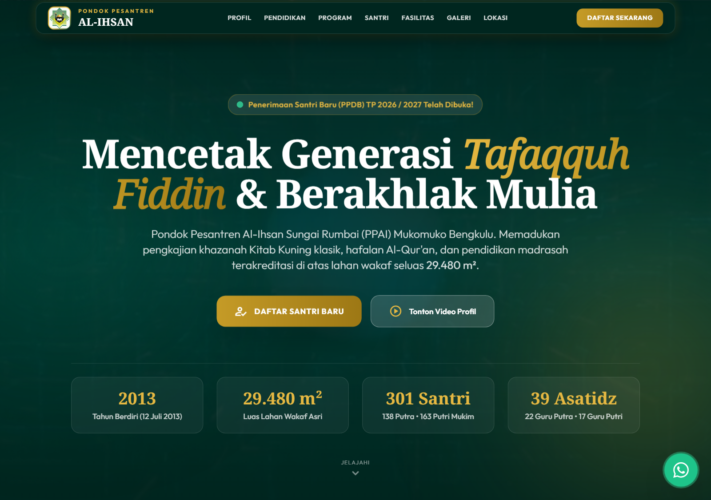

---

### 2. Profil & Legalitas Pesantren
Memuat data legalitas resmi (NSPP, Akta Notaris, Izin Kemenag), status tanah wakaf 29.480 m², rekening BSI resmi berfitur salin instan, profil Pimpinan Yayasan (H. Yakub) & Pengasuh (Ustadz Jalil), serta tab interaktif Visi & Misi.

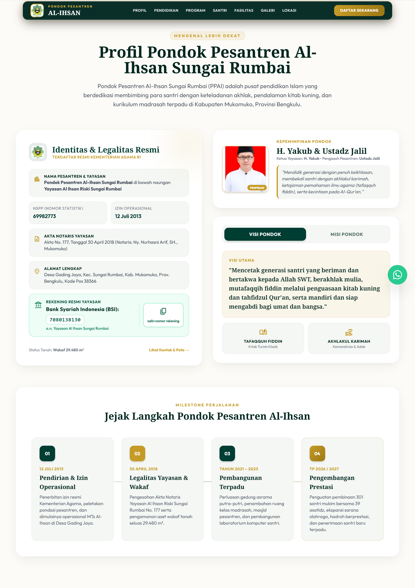

---

### 3. Satuan Pendidikan (MTs & MA)
Penjelasan jenjang Madrasah Tsanawiyah (MTs) Al-Ihsan terakreditasi dan Madrasah Aliyah (MA) Al-Ihsan berbasis integrasi kurikulum Kemenag dan kurikulum pesantren salafiyah.

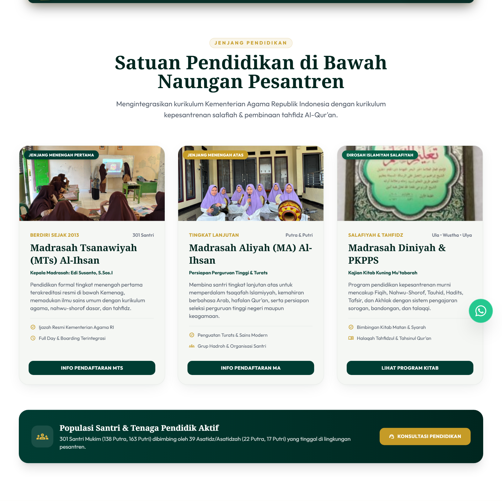

---

### 4. Program Unggulan & Khazanah Kitab Kuning
Rincian kurikulum unggulan: Tahfidzul Qur'an mutqin, pengkajian kitab kuning klasik berjenjang (*Safinatun Naja*, *Fathul Qorib*, *Jurumiyah*, *Imrithi*, *Alfiyah Ibnu Malik*, *Bulughul Maram*), pembiasaan Bahasa Arab/Inggris, serta madrasah diniyah malam.

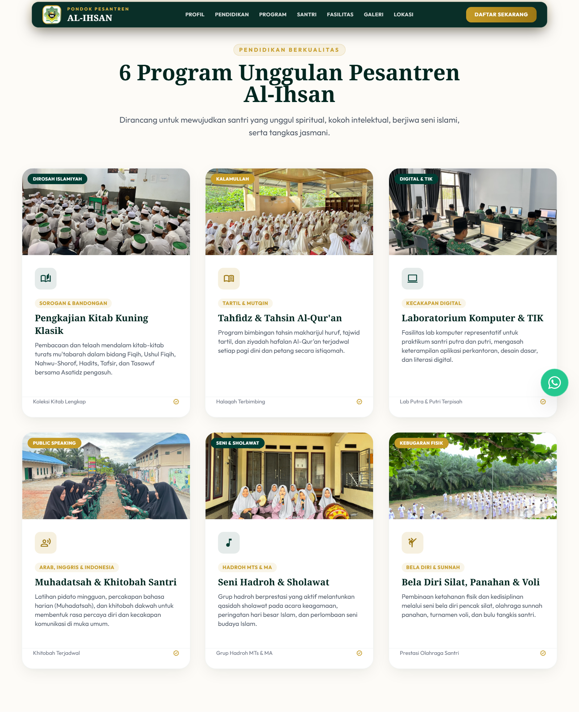

---

### 5. Kehidupan Santri & Ekstrakurikuler
Jadwal rutinitas harian santri 24 jam (mulai tahajud & subuh hingga istirahat malam) serta ragam ekstrakurikuler santri (Seni Hadroh, Silat Pagar Nusa, Panahan Sunnah, Olahraga Voli/Futsal, Pramuka, dan Muhadharah/Pidato 3 Bahasa).

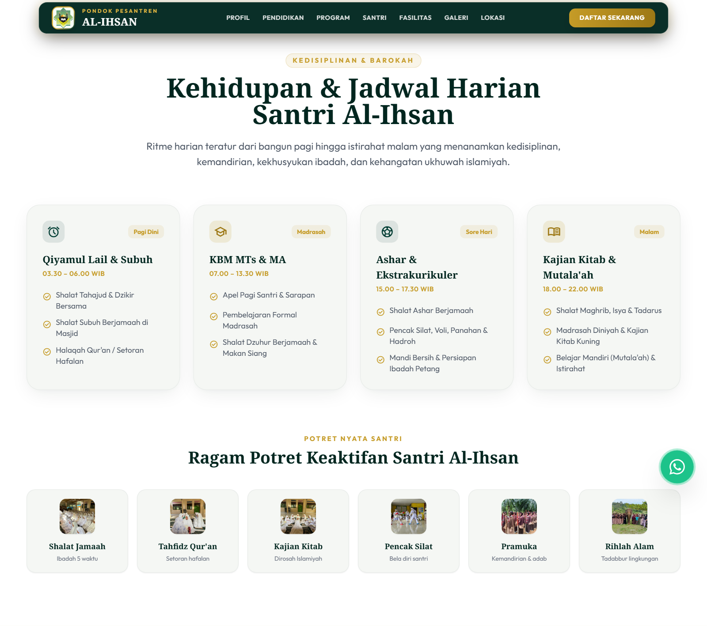

---

### 6. Fasilitas & Sarana Prasarana
Informasi sarana penunjang kenyamanan belajar dan bermukim santri: Masjid Jami' Al-Ihsan, Asrama Putra & Putri terpisah, Laboratorium Komputer, Ruang Kelas Representatif, Dapur Umum & Katering Sehat, Sarana Olahraga, dan Kantin Koperasi Santri.

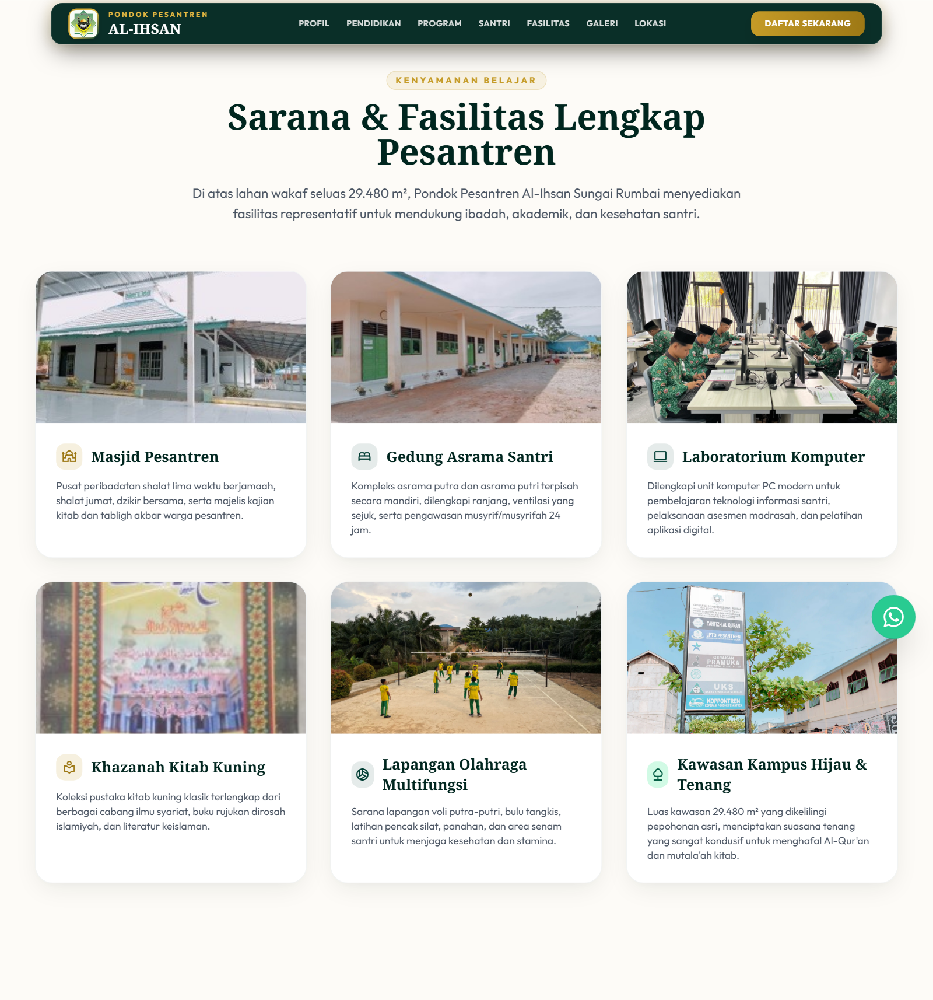

---

### 7. Galeri & Dokumentasi Kegiatan
Dokumentasi 30+ foto kegiatan asli santri dan dewan guru di lingkungan Pondok Pesantren Al-Ihsan Sungai Rumbai dengan filter kategori interaktif.

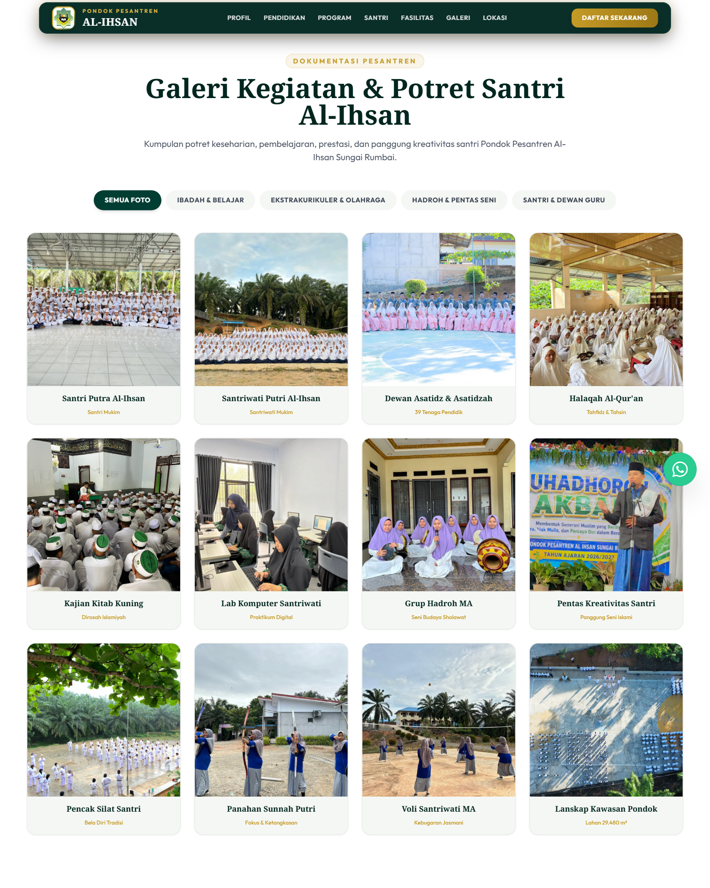

---

### 8. Informasi & Alur Pendaftaran Santri Baru (PPDB)
Langkah 4 tahap pendaftaran (Akses Portal, Pembayaran Administrasi, Tes Seleksi & Observasi, Daftar Ulang), syarat kelengkapan berkas, nomor rekening resmi dengan tombol salin, konfirmasi WhatsApp, dan tautan langsung ke portal pendaftaran online.

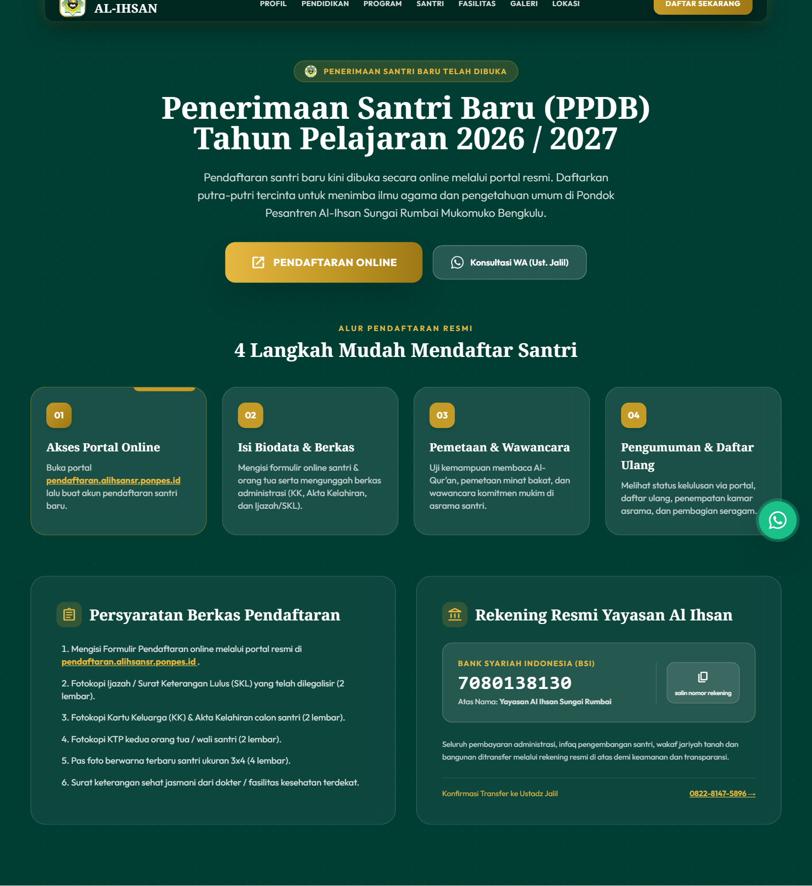

---

### 9. Lokasi & Peta Google Maps
Peta interaktif Google Maps yang disematkan langsung untuk memudahkan penelusuran lokasi kampus pesantren di Desa Gading Jaya, Sungai Rumbai, Mukomuko, Bengkulu.

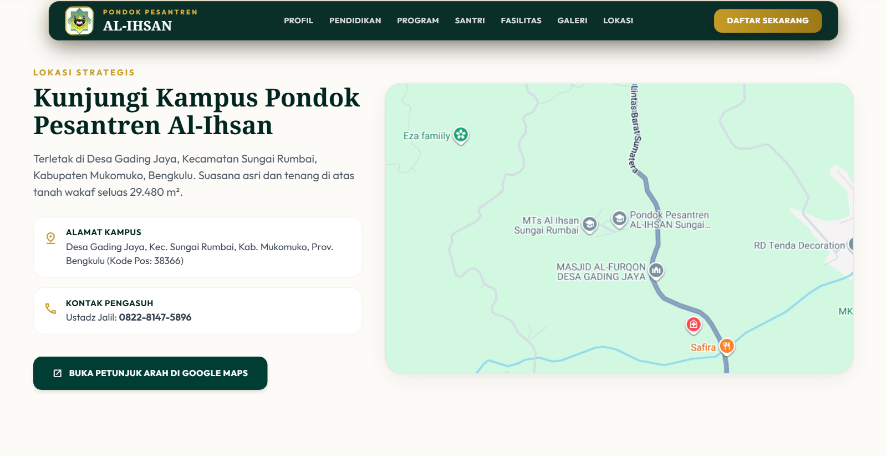

---

### 10. Tanya Jawab Santri Baru (FAQ)
Daftar pertanyaan yang paling sering diajukan calon wali santri seputar syarat umur, mukim/asrama, kunjungan orang tua, perizinan, dan pembiayaan dengan fitur buka-tutup akordion (*accordion*).

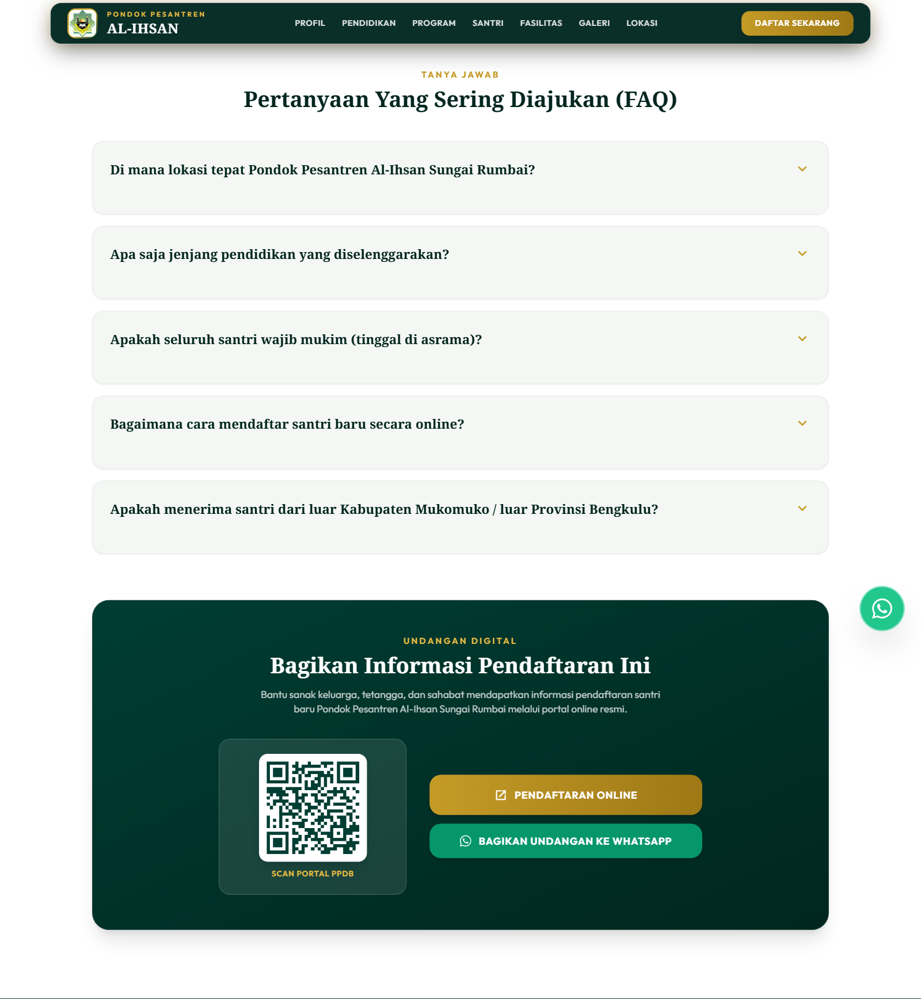

---

### 11. Footer & Layanan Kontak Resmi
Bagian penutup halaman yang memuat ringkasan identitas pesantren, tautan navigasi cepat, nomor rekening donasi/wakaf, serta kanal komunikasi resmi (Portal Online, WhatsApp Pengasuh, YouTube, dan Instagram) dengan ikon vektor mono dari *thesvg.org*.

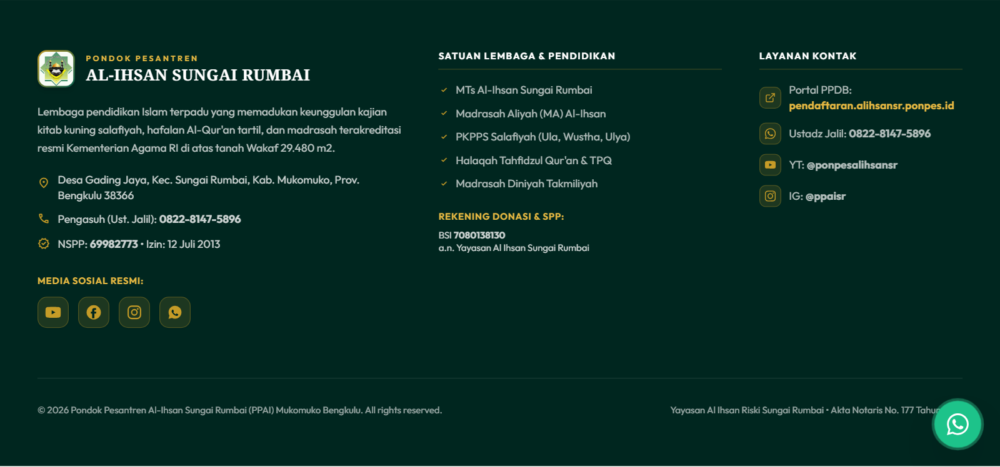

---

## 📂 Struktur Berkas Proyek

```plaintext
Web PPDB Al Ihsan/
├── index.html                           # Berkas utama website landing page PPDB
├── README.md                            # Dokumentasi lengkap proyek & showcase
├── Data Profil Pesantren Al Ihsan.md    # Dokumen rujukan profil otentik pesantren
├── FORM PROFIL PONDOK PESANTREN.docx    # Berkas sumber data profil resmi
│
├── Media/                               # Aset foto & logo resmi Al-Ihsan
│   ├── Logo.jpg                         # Logo resmi pesantren & favicon
│   ├── Pimpinan Yayasan.jpg             # Foto H. Yakub & Ustadz Jalil
│   ├── Lanscape Bangunan Gedung.webp    # Latar gedung & fallback video hero
│   ├── Asrama Putri.jpg                 # Dokumentasi asrama santri putri
│   ├── Masjid dan Santri.jpg            # Dokumentasi masjid & jamaah
│   ├── Lab Komputer.jpg                 # Sarana lab komputer santri
│   ├── Ekstra Hadroh.jpg                # Kegiatan seni hadroh
│   ├── Ekstra Silat.jpg                 # Kegiatan bela diri silat
│   ├── Ekstra Panahan.jpg               # Kegiatan panahan sunnah
│   ├── Ekstra Voli.jpg                  # Lapangan & olahraga santri
│   ├── Ekstra Pramuka.jpg               # Ekstrakurikuler pramuka
│   ├── Kegiatan Pentas Santri.jpg       # Panggung apresiasi santri
│   ├── Dewan Guru Putri.jpg             # Foto asatidzah pondok
│   ├── Dewan Guru Putra.jpg             # Foto asatidz pondok
│   └── ...                              # Foto dokumentasi lainnya
│
└── screenshots/                         # Tangkapan layar dokumentasi per section
    ├── 01-hero.png
    ├── 02-profil.png
    ├── 03-satuan-pendidikan.png
    ├── 04-program.png
    ├── 05-kehidupan-santri.png
    ├── 06-fasilitas.png
    ├── 07-galeri.png
    ├── 08-ppdb.png
    ├── 09-lokasi.png
    ├── 10-faq.png
    └── 11-footer.png
```

---

## 🛠️ Teknologi & Pustaka

- **HTML5**: Struktur semantik dengan optimasi SEO & Accessibility (ARIA).
- **Tailwind CSS (JIT via CDN)**: Penataan tata letak responsif, sistem grid fleksibel, palet warna kustom (*forest, emerald, gold, cream*).
- **YouTube IFrame Player API**: Pemutaran video latar belakang otomatis, loop, mute, dan modal player interaktif.
- **Google Fonts**: Tipografi modern (*Outfit* untuk sans-serif, *Noto Serif* untuk aksen klasik, *Amiri* untuk teks Arab).
- **Material Symbols Outlined**: Simbol antarmuka standar Google.
- **TheSVG.org Vector Icons**: Ikon vektor merek resmi (WhatsApp, YouTube, Instagram) dalam format mono yang menyatu dengan palet tema.
- **Clipboard API**: Fitur salin nomor rekening instan dengan *graceful fallback*.

---

## 💻 Cara Menjalankan Secara Lokal

Halaman ini dibuat dengan arsitektur *pure static client-side*, sehingga tidak memerlukan instalasi backend maupun kompilasi rumit.

### Opsi 1: Menggunakan VS Code Live Server
1. Buka folder proyek ini di Visual Studio Code.
2. Klik kanan pada berkas `index.html`.
3. Pilih **Open with Live Server**.

### Opsi 2: Menggunakan Python
```bash
# Jalankan server lokal pada port 8000
python -m http.server 8000
```
Buka browser dan akses `http://localhost:8000`.

### Opsi 3: Menggunakan Node.js `npx serve`
```bash
npx serve .
```

---

## 🌐 Deployment (Vercel)

Proyek ini telah dikonfigurasi untuk langsung di-*deploy* melalui **Vercel**:
1. Hubungkan repository GitHub ke dashboard Vercel, atau jalankan perintah CLI:
   ```bash
   vercel --prod
   ```
2. Website live dapat diakses melalui domain:  
   👉 **[https://webppdb-alihsansr.vercel.app](https://webppdb-alihsansr.vercel.app)**

---

## 📞 Kontak & Informasi Lebih Lanjut

- **Sekretariat PPDB:** Pondok Pesantren Al-Ihsan Sungai Rumbai, Desa Gading Jaya, Kec. Sungai Rumbai, Kab. Mukomuko, Prov. Bengkulu (Kode Pos 38366).
- **WhatsApp Pengasuh (Ustadz Jalil):** [0822-8147-5896](https://wa.me/6282281475896)
- **Portal Registrasi Online:** [pendaftaran.alihsansr.ponpes.id](https://pendaftaran.alihsansr.ponpes.id)
- **YouTube Resmi:** [@ponpesalihsansr](https://www.youtube.com/@ponpesalihsansr)
- **Instagram Resmi:** [@ppaisr](https://www.instagram.com/ppaisr/)

---
*© 2026 Pondok Pesantren Al-Ihsan Sungai Rumbai. Hak Cipta Dilindungi Undang-Undang.*

